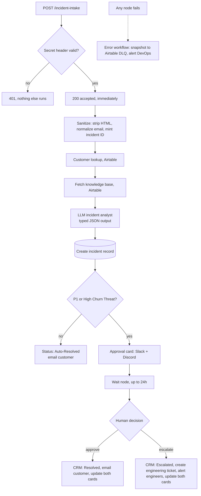

# Case Study: Autonomous Incident Platform

**An n8n system that triages customer incidents with an LLM, resolves the low-risk ones on its own, and stops to ask a human before anything high-risk goes out.**

   

| | |
|---|---|
| **Type** | Portfolio build (reference implementation, not a client engagement) |
| **My role** | Sole designer and builder: workflow design, prompt and schema design, integrations, failure handling |
| **Scale** | 3 workflows, 30 nodes in the main flow, 4 external systems, 2 chat platforms |
| **Stack** | n8n, OpenRouter (LLM), Airtable, Resend, Slack API, Discord API, GitHub Issues API |
| **Status** | Runs end to end on sample data; tested on 100 synthetic incidents (results below). |

---

## The problem

Support and engineering teams lose time at the start of every incident, before any fixing happens. Someone has to clean up the report, find out who the customer is and how much they matter, search for a known fix, judge how serious it is, and tell the right people. Done by hand, that is slow and inconsistent, and the cost lands where it hurts: a furious high-value customer waits in the same queue as a routine FAQ.

The obvious fix, "let an AI answer everything", is worse. An unsupervised model that emails an angry enterprise customer is a liability. The real design problem is **deciding which incidents a machine may close by itself and which need a person**, and making that decision explicit and auditable rather than implicit in a prompt.

## Outcome

- Every incident is cleaned, enriched with customer and knowledge-base context, analysed and logged in seconds, without a person touching it.
- Routine incidents (general questions, standard billing) are resolved automatically.
- Anything that is a **P1 outage or a churn threat** pauses for a human decision in Slack or Discord. The run is suspended, not abandoned, and resumes when someone clicks.
- Engineering gets a GitHub issue and an alert only when a person chooses to escalate.
- If any step fails, a dead-letter workflow records it and alerts on-call. Nothing fails silently.
- Tested on 100 synthetic incidents with the expected outcome written down first: every one took the right path, all 12 P1 and churn-threat cases paused for a person, and 4 of 4 deliberate failures were caught and alerted.

---

## Architecture



### Stage by stage

| # | Stage | What it does | Why it is built this way |
|---|---|---|---|
| 1 | **Authenticated intake** | Checks a shared-secret header before anything else. Bad or missing secret returns `401`. | The cheapest place to reject abuse is before any lookup or LLM call costs money. |
| 2 | **Early acknowledge** | Responds `200` right after validation, then continues. | The caller is not held open for an LLM round trip, and a slow model cannot cause a webhook timeout and a duplicate submission. |
| 3 | **Sanitize** | Strips HTML tags from the message, trims and lowercases the email, mints an `INC-YYYY-NNNNNN` ID, stamps a fixed-timezone timestamp. | Untrusted text is cleaned once, up front, so no downstream node or prompt sees raw markup. |
| 4 | **Context** | Looks up the customer by email (tier, lifetime value, assigned executive) and loads the knowledge base. | The model judges an incident better when it knows the customer is a high-value account and which fixes are already verified. |
| 5 | **Analyst** | An LLM chain with a structured output parser returns the incident analysis (schema below). | Typed output turns an AI answer into something a rule can route on. |
| 6 | **Record** | Writes the incident, analysis and approval status to Airtable *before* notifying anyone. | The record exists even if a later notification fails. |
| 7 | **Risk gate** | A deterministic expression sets `Pending Human Approval` or `Auto-Resolved`. | Policy lives in auditable logic, not in a prompt the model could talk itself out of. |
| 8 | **Human gate** | Posts a card to Slack and Discord, then suspends on a Wait node. | A human decision can take any length of time without holding a worker. |
| 9 | **Resolution** | Approve: resolve and notify the customer. Escalate: open an engineering ticket and alert the team. Cards are edited in place to show the outcome. | Everyone looking at either channel sees the final state, not a stale button. |
| 10 | **Failure handling** | A global error workflow logs the failure to a dead-letter table and alerts DevOps. | Silent failure is the worst failure mode in an unattended system. |

---

## Deep dives

### The analyst contract

The model is not asked to "write a response". It is asked to return this object, enforced by a structured output parser:

```jsonc
{
  "category":                "Outage / Critical Bug | Billing & Invoicing | Feature Request | General FAQ",
  "sentiment_score":         "integer 1 (furious) to 5 (delighted)",
  "churn_risk":              "High Churn Threat | Normal",
  "urgency_level":           "P1 - Critical | P2 - High | P3 - Standard",
  "technical_bug_detected":  "boolean",
  "resolution_draft":        "empathetic customer reply, grounded in a matching KB article if one exists"
}
```

The prompt supplies the customer's tier and lifetime value alongside the incident text and the knowledge base, and instructs the model to use verified KB solutions rather than invent them. Closed enums are the point: free text cannot be reliably branched on, a `P1 - Critical` string can.

### The risk gate is code, not a prompt

```js
Human_Approval_Status =
  churn_risk === 'High Churn Threat' || urgency_level === 'P1 - Critical'
    ? 'Pending Human Approval'
    : 'Auto-Resolved'
```

The model *classifies*; this expression *decides*. If the model is wrong about sentiment, the blast radius is bounded by a rule I can read, test and change. This is the single most important design choice in the system.

### Human-in-the-loop that survives time

1. The approval card is posted to Slack and Discord with buttons whose value carries the decision and n8n's per-execution resume URL.
2. The main run is suspended on a **Wait node** (webhook resume, 24-hour limit).
3. A separate **interactions router** workflow receives the Slack/Discord click, can open a verification modal, then calls the resume URL with `decision=approved|escalated`.
4. A **Switch** node on that query parameter sends the run down the approve or escalate branch.
5. Both cards are edited in place (`chat.update` on Slack, `PATCH` on Discord) so the channel shows the outcome.


### Dead-letter queue

Each workflow points its **Error workflow** setting at one handler. On any unhandled failure it builds a snapshot (workflow, node, message, execution link), writes it to an Airtable DLQ table and posts an alert to Slack and Discord. The design goal is that an unattended system can be left alone because it will say so when it breaks.

---

## Decision log

### Decision 1: risk-tiered autonomy, not all-or-nothing
- **Options:** (a) human approves everything, (b) AI sends everything, (c) AI sends low-risk, human approves high-risk.
- **Chose (c).** (a) does not remove the bottleneck; (b) is unsafe.
- **Safeguard:** routing uses a two-field rule (`P1` *or* churn threat), which errs toward asking a human.

### Decision 2: structured output over free text
- Enums and a typed schema let the workflow branch deterministically and make Airtable columns clean. The parser on the chain enforces the schema.

### Decision 3: acknowledge first, work after
- Returning `200` before the LLM call decouples the caller from model latency. Results go to Airtable and chat instead of the HTTP response.

### Decision 4: write the record before notifying
- A failed Slack call cannot lose an incident.

### Decision 5: two chat platforms, one router
- Cards go to Slack and Discord and a single router handles both. The pattern is reusable and not tied to one vendor.

---

## Failure modes I designed for

| What goes wrong | What happens |
|---|---|
| Missing or wrong secret | `401`, no data touched, no LLM cost |
| Customer not in the CRM | The prompt carries fallbacks ("Unknown / New Customer", `Free Starter`, $0 LTV). Both lookups always output data, so the run continues with these defaults and cards show "Unknown customer". |
| Nobody answers the card | The Wait node has a 24-hour limit instead of hanging forever |
| Any node throws | Error workflow logs a DLQ record and alerts DevOps in two channels |
| HTML or script in the message | Stripped at intake before any prompt sees it |

## Data model

Airtable base with three tables used by this flow.

| Table | Fields used |
|---|---|
| **Customers** | `Primary_Email`, `Company_Name`, `Customer_Name`, `Account_Tier`, `Lifetime_Value_USD`, `Assigned_Executive` |
| **Knowledge Base** | `Topic`, `Keywords`, `Verified_Solution` |
| **Incidents** | `Incident_ID`, `Customer_Email`, `Subject`, `Raw_Message`, `Category`, `Sentiment_Score`, `Churn_Risk`, `Resolution_Draft`, `Human_Approval_Status`, `Status`, `Timestamp` |


## Testing and verification

**Results.** 100 synthetic incidents were sent through the live webhook (billing, access, how-to, feature requests, outage and churn threats, hostile text, unknown customers). The expected route for each was written down before sending.

| Measure | Result |
|---|---|
| Routed to the correct path (auto-resolve or human approval) | 100 of 100 |
| P1 and churn-threat incidents paused for a person | 12 of 12 |
| Routine incidents wrongly escalated | 0 of 88 |
| Hostile or odd text (quotes, HTML, formula, very long, unicode) handled | 6 of 6 |
| Customers not in the CRM handled | 6 of 6 |
| Intake to resolved, auto-resolved incidents | median 14 s over 88 runs |
| Approval click to resolved | 3 to 4 s |
| Deliberate failures logged and alerted in two channels | 4 of 4, within 4 s |

[`samples/incident-intake.json`](samples/incident-intake.json) is a ready payload. Send it with the secret header and watch the execution; the path taken depends on the analysis. Paths exercised end to end on the running workflow:

- **Routine question** (password reset, invoice copy): auto-resolved, the customer is emailed at the incident's own address, the incident is logged.
- **P1 outage with a churn threat:** approval cards post to Slack and Discord, the run pauses, and a signed approval resumes it to Resolved.
- **Escalation:** the same incident escalated instead raises the engineering ticket, alerts the team and updates both cards (the ticket call was exercised against a mock endpoint; the export targets the GitHub Issues API).
- **Customer not in the CRM:** the run continues with defaults and the cards read `Unknown customer`.
- **Hostile input:** an email containing a quote is escaped before it reaches the Airtable filter formula.
- **Unique IDs:** each incident ID is derived from the n8n execution ID.
- **Knowledge-base selection:** the keyword matching was checked against the real articles; an invoice question pulled only the billing article into the prompt.

## Configuration and swap-ins

Everything below is a setting or a node swap, not a rewrite. The defaults are what I used because they are free or cheapest, not because the design needs them.

| What | Default here | Change it to |
|---|---|---|
| **LLM** | OpenRouter's free router (`openrouter/free`) | Any chat model n8n supports: OpenAI, Anthropic, Gemini, a local Ollama model. Swap the model node; the structured parser stays. A stronger model gives more reliable classification. |
| **Risk gate** | `P1 - Critical` or `High Churn Threat` needs a human | Edit the one expression in the Create Incident node: add categories, use `sentiment_score`, or gate on customer tier or lifetime value. |
| **Approval wait** | 24 hours | Any limit, or none. Set what happens on timeout. |
| **Chat platforms** | Slack and Discord | Either one alone, Teams, or email approval. Remove the unused branch. |
| **CRM / database** | Airtable | Supabase, Postgres, HubSpot, Notion, Google Sheets. Replace the Airtable nodes and keep the field names. |
| **Customer email** | Resend (use a verified sending domain to reach arbitrary recipients) | Gmail, SMTP, SendGrid, Postmark. |
| **Ticketing** | GitHub Issues through the REST API (retries 3 times; the CRM stores the real issue URL) | Jira, Linear, GitLab, ClickUp. Change the URL, auth and body of that one node. |
| **Knowledge base** | Keyword-filtered, top 3 in the prompt | A vector store when the KB grows. |
| **Timezone and ID format** | Fixed timezone, `INC-YYYY-NNNNNN` | Any. |

## What this demonstrates

- Designing **human-in-the-loop** systems where autonomy is bounded by explicit policy.
- **Structured LLM output** used as a routing input, with closed enums.
- **Long-running, resumable workflows** (Wait node and webhook resume) with interactive chat approvals.
- **Multi-system orchestration**: CRM, email, chat, ticketing, error handling.
- **Operational thinking**: authentication, early acknowledge, dead-letter queue, input sanitization.

## Repository

| File | Purpose |
|---|---|
| [`workflows/01-incident-intake-and-triage.json`](workflows/01-incident-intake-and-triage.json) | Main flow: intake, analysis, risk gate, approval, outcomes |
| [`workflows/02-interactions-router.json`](workflows/02-interactions-router.json) | Slack/Discord interaction handler (verification modals and run resume) |
| [`workflows/03-error-handler-dlq.json`](workflows/03-error-handler-dlq.json) | Global error workflow and dead-letter queue |
| [`samples/incident-intake.json`](samples/incident-intake.json) | Sample request payload |

### Run it yourself
1. Import the three workflows into n8n (1.x or 2.x). All are exported **inactive**.
2. Create three **Header Auth** credentials (`Resend API` with `Authorization: Bearer <key>`, `Slack Bot Token` with `Authorization: Bearer <token>`, `Discord Bot` with `Authorization: Bot <token>`), plus Airtable and OpenRouter credentials. Replace every placeholder (`REPLACE_ME`, `YOUR_*`, `WORKFLOW_ID_*`) and re-select your own credentials. Re-link the Execute Workflow and error-workflow settings to your imported copies.
3. Create the three Airtable tables above.
4. In the escalation node, set your repository (`YOUR_OWNER/YOUR_REPO`) and attach a GitHub credential (a fine-grained token with Issues: write on that repository).
5. Send the sample payload:

   ```bash
   curl -X POST https://YOUR-N8N-HOST/webhook/incident-intake \
     -H "x-intake-secret: YOUR_SHARED_SECRET" \
     -H "Content-Type: application/json" \
     -d @samples/incident-intake.json
   ```

Brand names, people and addresses are fictional demo data. MIT licensed.
