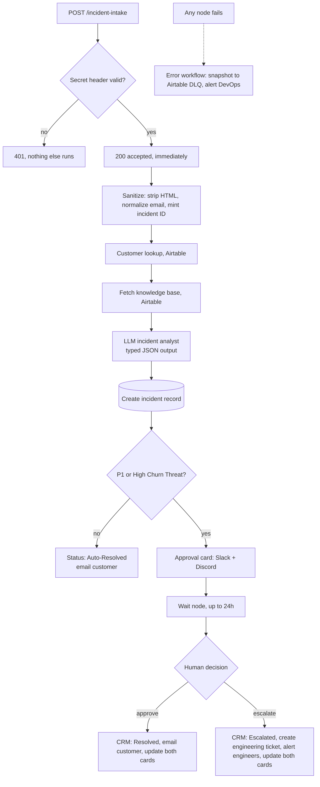

# Case Study: Autonomous Incident Platform

**An n8n system that triages customer incidents with an LLM, resolves the low-risk ones on its own, and stops to ask a human before anything high-risk goes out.**

   

| | |
|---|---|
| **Type** | Portfolio build (reference implementation, not a client engagement) |
| **My role** | Sole designer and builder: workflow design, prompt and schema design, integrations, failure handling |
| **Scale** | 3 workflows, 29 nodes in the main flow, 4 external systems, 2 chat platforms |
| **Stack** | n8n, OpenRouter (LLM), Airtable, Resend, Slack API, Discord API, GitHub Issues API |
| **Status** | Runs end to end on sample data. Has not handled real customer traffic. Known gaps are listed at the bottom. |

> **If you only read one section:** [Why this is interesting](#why-this-is-interesting) and [What I would fix next](#what-i-would-fix-next).

---

## The problem

Support and engineering teams lose time at the start of every incident, before any fixing happens. Someone has to clean up the report, find out who the customer is and how much they matter, search for a known fix, judge how serious it is, and tell the right people. Done by hand, that is slow and inconsistent, and the cost lands where it hurts: a furious high-value customer waits in the same queue as a routine FAQ.

The obvious fix, "let an AI answer everything", is worse. An unsupervised model that emails an angry enterprise customer is a liability. The real design problem is **deciding which incidents a machine may close by itself and which need a person**, and making that decision explicit and auditable rather than implicit in a prompt.

## Outcome

- Every incident is cleaned, enriched with customer and knowledge-base context, analysed and logged in seconds, without a person touching it.
- Routine incidents (general questions, standard billing) are resolved automatically.
- Anything that is a **P1 outage or a churn threat** pauses for a human decision in Slack or Discord. The run is suspended, not abandoned, and resumes when someone clicks.
- Engineering gets a GitHub issue and an alert only when a person chooses to escalate.
- If any step fails, a dead-letter workflow records it and alerts on-call. Nothing fails silently.

## Why this is interesting

1. **Autonomy is tiered by risk, not switched on or off.** The model never decides *whether* a human is needed; a deterministic rule on its structured output does. See [Decision 1](#decision-1-risk-tiered-autonomy-not-all-or-nothing).
2. **The model returns a typed object, not prose.** Enums for category, urgency and churn risk mean the workflow can branch on the result safely.
3. **The run can wait.** A Wait node suspends the execution and a Slack button resumes it, so a human decision can take minutes or hours without holding a worker or losing state.
4. **Known gaps are documented.** The last section lists the real defects I found auditing my own build.

---

## Architecture



### Stage by stage

| # | Stage | What it does | Why it is built this way |
|---|---|---|---|
| 1 | **Authenticated intake** | Checks a shared-secret header before anything else. Bad or missing secret returns `401`. | The cheapest place to reject abuse is before any lookup or LLM call costs money. |
| 2 | **Early acknowledge** | Responds `200` right after validation, then continues. | The caller is not held open for an LLM round trip, and a slow model cannot cause a webhook timeout and a duplicate submission. |
| 3 | **Sanitize** | Strips HTML tags from the message, trims and lowercases the email, mints an `INC-YYYY-NNNNNN` ID, stamps a fixed-timezone timestamp. | Untrusted text is cleaned once, up front, so no downstream node or prompt sees raw markup. |
| 4 | **Context** | Looks up the customer by email (tier, lifetime value, assigned executive) and loads the knowledge base. | The model judges an incident better when it knows the customer is a high-value account and which fixes are already verified. |
| 5 | **Analyst** | An LLM chain with a structured output parser returns the incident analysis (schema below). | Typed output turns an AI answer into something a rule can route on. |
| 6 | **Record** | Writes the incident, analysis and approval status to Airtable *before* notifying anyone. | The record exists even if a later notification fails. |
| 7 | **Risk gate** | A deterministic expression sets `Pending Human Approval` or `Auto-Resolved`. | Policy lives in auditable logic, not in a prompt the model could talk itself out of. |
| 8 | **Human gate** | Posts a card to Slack and Discord, then suspends on a Wait node. | A human decision can take any length of time without holding a worker. |
| 9 | **Resolution** | Approve: resolve and notify the customer. Escalate: open an engineering ticket and alert the team. Cards are edited in place to show the outcome. | Everyone looking at either channel sees the final state, not a stale button. |
| 10 | **Failure handling** | A global error workflow logs the failure to a dead-letter table and alerts DevOps. | Silent failure is the worst failure mode in an unattended system. |

---

## Deep dives

### The analyst contract

The model is not asked to "write a response". It is asked to return this object, enforced by a structured output parser:

```jsonc
{
  "category":                "Outage / Critical Bug | Billing & Invoicing | Feature Request | General FAQ",
  "sentiment_score":         "integer 1 (furious) to 5 (delighted)",
  "churn_risk":              "High Churn Threat | Normal",
  "urgency_level":           "P1 - Critical | P2 - High | P3 - Standard",
  "technical_bug_detected":  "boolean",
  "resolution_draft":        "empathetic customer reply, grounded in a matching KB article if one exists"
}
```

The prompt supplies the customer's tier and lifetime value alongside the incident text and the knowledge base, and instructs the model to use verified KB solutions rather than invent them. Closed enums are the point: free text cannot be reliably branched on, a `P1 - Critical` string can.

### The risk gate is code, not a prompt

```js
Human_Approval_Status =
  churn_risk === 'High Churn Threat' || urgency_level === 'P1 - Critical'
    ? 'Pending Human Approval'
    : 'Auto-Resolved'
```

The model *classifies*; this expression *decides*. If the model is wrong about sentiment, the blast radius is bounded by a rule I can read, test and change. This is the single most important design choice in the system.

### Human-in-the-loop that survives time

1. The approval card is posted to Slack and Discord with buttons whose value carries the decision and n8n's per-execution resume URL.
2. The main run is suspended on a **Wait node** (webhook resume, 24-hour limit).
3. A separate **interactions router** workflow receives the Slack/Discord click, can open a verification modal, then calls the resume URL with `decision=approved|escalated`.
4. A **Switch** node on that query parameter sends the run down the approve or escalate branch.
5. Both cards are edited in place (`chat.update` on Slack, `PATCH` on Discord) so the channel shows the outcome.

The router is its own workflow on purpose: one public interaction endpoint serves every approval flow, and it is shared with the [lead waterfall](https://github.com/lomonol/n8n-lead-waterfall-engine) and [support](https://github.com/lomonol/n8n-support-warranty-automation) systems.

### Dead-letter queue

Every workflow in the set points its **Error workflow** setting at one handler. On any unhandled failure it builds a snapshot (workflow, node, message, execution link), writes it to an Airtable DLQ table and posts an alert to Slack and Discord. The design goal is that an unattended system can be left alone because it will say so when it breaks.

---

## Decision log

### Decision 1: risk-tiered autonomy, not all-or-nothing
- **Options:** (a) human approves everything, (b) AI sends everything, (c) AI sends low-risk, human approves high-risk.
- **Chose (c).** (a) does not remove the bottleneck; (b) is unsafe.
- **Trade-off:** correctness now depends on the classification being roughly right. Mitigated by routing on a two-field rule (`P1` *or* churn threat), which errs toward asking a human.

### Decision 2: structured output over free text
- Enums and a typed schema let the workflow branch deterministically and make Airtable columns clean. Cost: the model must be prompted with the schema and can occasionally fail to conform, which is why the parser sits on the chain.

### Decision 3: acknowledge first, work after
- Returning `200` before the LLM call decouples the caller from model latency. Cost: the caller cannot receive the analysis in the HTTP response, so results go to Airtable and chat instead.

### Decision 4: write the record before notifying
- A failed Slack call cannot lose an incident. Cost: one extra write per run.

### Decision 5: two chat platforms, one router
- Cards go to Slack and Discord and a single router handles both. Cost: more moving parts than one platform; benefit: the pattern is reusable and not locked to one vendor.

---

## Failure modes I designed for

| What goes wrong | What happens |
|---|---|
| Missing or wrong secret | `401`, no data touched, no LLM cost |
| Customer not in the CRM | The prompt carries fallbacks ("Unknown / New Customer", `Free Starter`, $0 LTV). Tested live with an unknown email: both lookups are set to always output data, so the run falls through to these defaults instead of ending silently. |
| Nobody answers the card | The Wait node has a 24-hour limit instead of hanging forever |
| Any node throws | Error workflow logs a DLQ record and alerts DevOps in two channels |
| HTML or script in the message | Stripped at intake before any prompt sees it |

## Data model

Airtable base with three tables used by this flow.

| Table | Fields used |
|---|---|
| **Customers** | `Primary_Email`, `Company_Name`, `Customer_Name`, `Account_Tier`, `Lifetime_Value_USD`, `Assigned_Executive` |
| **Knowledge Base** | `Topic`, `Keywords`, `Verified_Solution` |
| **Incidents** | `Incident_ID`, `Customer_Email`, `Subject`, `Raw_Message`, `Category`, `Sentiment_Score`, `Churn_Risk`, `Resolution_Draft`, `Human_Approval_Status`, `Status`, `Timestamp` |

The interactions router also uses Supabase (`support_tickets`, `support_orders`, `outbound_inbound_replies`) because it serves the sibling systems too.

## Testing and verification

I have **not recorded measured results** for this build yet, and I would rather say so than quote a made-up number. What exists:

- [`samples/incident-intake.json`](samples/incident-intake.json) is a ready payload. Send it with the secret header and watch the execution; the path taken depends on the analysis.
- Two cases worth running: an angry "checkout is down" message (should hit `P1`, pause, and post cards) and a polite FAQ (should auto-resolve).
- Pending: a 20-incident test set with expected routing, so routing accuracy can be reported as a real number.

## Fixed and verified

Each fix below was applied to the live workflow and checked with a real execution, not just edited.

- **Customer email goes to the incident's own address.** The Resend call used a fixed address. It now sends to the sanitized `customer_email`. Verified with a run whose `customer_email` was a different address: the request body carried that address and Resend rejected it with its sandbox error (`onboarding@resend.dev` only delivers to the account owner). So the recipient is dynamic; sending to real customers needs a verified sending domain.
- **Empty lookups fall through.** `Lookup Customer` and `Fetch Knowledge Base` now always output data. Before, an unknown customer ended the run right after the lookup with a "success" status and no email, CRM row or alert. After, the run continues with the prompt's defaults ("Valued Client", Standard tier) and writes the CRM row.
- **Auto-resolved incidents no longer end in an error.** The auto-resolve path shared the "approved" card-update nodes, which reference an approval card that is never posted on that path, so every auto-resolved run showed as failed after the customer was emailed. A new `Approval Card Posted?` check skips the card updates when no card exists. Verified: an auto-resolved run now finishes with status success and the email sent.
- **Alert node names match their destinations.** The node labelled "Slack" posted to a Discord webhook and the one labelled "Discord" posted to Slack. Swapped the names (parameters untouched) and confirmed on the published workflow that each name now matches its URL and the escalation chain is still connected. The escalation path was later run end to end and finished successfully.
- **Formula injection closed.** The customer lookup builds an Airtable `filterByFormula` from the submitted email. Backslashes and single quotes are now escaped before interpolation. Verified with an email containing a quote (`o'brien@...`): before the fix the lookup failed with `INVALID_FILTER_BY_FORMULA`, which shows the input was reaching the formula text; after the fix the lookup runs cleanly and returns no match. Escaping is the minimal fix; a record-ID lookup would remove the formula entirely.
- **Incident IDs cannot collide.** They were `INC-YYYY-` plus four random digits, which collides at roughly a hundred incidents a year. They now use the n8n execution ID, zero-padded (`INC-2026-000590`), which is unique per run by construction. Verified: the run with execution ID 590 produced `INC-2026-000590`. The ID depends on n8n's execution counter, so it is unique within one instance but not meaningful across instances or after a database reset.
- **Human-approval path verified with an unknown customer.** I had suspected the cards would error when the customer is not in the CRM. Running a P1 incident end to end showed they do not: both approval cards posted, the run paused, a signed approval resumed it, the cards updated, the customer was emailed and the execution finished with status success. The only defect is the blank customer name, listed below. This run also exercised the `Approval Card Posted?` check from the other side (card was posted, so card updates ran).
- **Unknown customers show as "Unknown customer" on cards.** Eleven card, alert and confirmation nodes now fall back to `Unknown customer` / `Unknown tier` instead of rendering blank. Verified on the approval card from a real run (`Customer: Unknown customer (Unknown tier)`). The escalation path was then run end to end as well: the escalated card updates, both engineering alerts and the confirmation page ran, the page showed `Unknown customer`, and the execution finished with status success. The ticket step posted to a mock endpoint, not a real repo. The approved card update was last run before this edit.
- **Approval card no longer names a model.** The Slack card said "Triaged by Claude 3.5 Sonnet" while the analyst node runs OpenRouter's `openrouter/free` router, which can serve different models. The text now says "Triaged by AI analyst". Verified by reading the published node back and confirming the new text is live. Not re-run, since it is a static string.
- **Knowledge base is keyword-filtered, not dumped whole.** Every article used to go into the prompt. The prompt now includes only the top three articles whose keywords share words with the incident's subject and message, or an explicit "no matching article, do not invent a solution" line. Checked the matching logic offline against the real five articles (password, invoice, rate-limit, webhook and an outage message that correctly matches nothing), then ran a live invoice question: the prompt got smaller (782 input tokens against 1,101 for an unfiltered run), and the resolution cited the billing article and its exact portal path. Word matching is crude: no stemming or synonyms, so "cancelling" will not match "cancel". Embeddings are the next step once the KB is large.

## What I would fix next

I audited my own build before publishing it. These are real defects, in priority order:

1. **Secrets live in node parameters.** The shared secret and some tokens were pasted into HTTP/IF nodes. They belong in n8n credentials. (They are stripped from this export; rotate anything that was ever pasted.)

## Configuration and swap-ins

Everything below is a setting or a node swap, not a rewrite. The defaults are what I used because they are free or cheapest, not because the design needs them.

| What | Default here | Change it to |
|---|---|---|
| **LLM** | OpenRouter's free router (`openrouter/free`) | Any chat model n8n supports: OpenAI, Anthropic, Gemini, a local Ollama model. Swap the model node; the structured parser stays. A stronger model gives more reliable classification. |
| **Risk gate** | `P1 - Critical` or `High Churn Threat` needs a human | Edit the one expression in the Create Incident node: add categories, use `sentiment_score`, or gate on customer tier or lifetime value. |
| **Approval wait** | 24 hours | Any limit, or none. Set what happens on timeout. |
| **Chat platforms** | Slack and Discord | Either one alone, Teams, or email approval. Remove the unused branch. |
| **CRM / database** | Airtable | Supabase, Postgres, HubSpot, Notion, Google Sheets. Replace the Airtable nodes and keep the field names. |
| **Customer email** | Resend | Gmail, SMTP, SendGrid, Postmark. |
| **Ticketing** | GitHub Issues through the REST API (retries 3 times; the CRM stores the real issue URL) | Jira, Linear, GitLab, ClickUp. Change the URL, auth and body of that one node. |
| **Knowledge base** | Keyword-filtered, top 3 in the prompt | A vector store when the KB grows. |
| **Timezone and ID format** | Fixed timezone, `INC-YYYY-NNNNNN` | Any. |

## What this demonstrates

- Designing **human-in-the-loop** systems where autonomy is bounded by explicit policy.
- **Structured LLM output** used as a routing input, with closed enums.
- **Long-running, resumable workflows** (Wait node and webhook resume) with interactive chat approvals.
- **Multi-system orchestration**: CRM, email, chat, ticketing, error handling.
- **Operational thinking**: authentication, early acknowledge, dead-letter queue, a written defect list.

## Repository

| File | Purpose |
|---|---|
| [`workflows/01-incident-intake-and-triage.json`](workflows/01-incident-intake-and-triage.json) | Main flow: intake, analysis, risk gate, approval, outcomes |
| [`workflows/02-interactions-router.json`](workflows/02-interactions-router.json) | Shared Slack/Discord interaction handler (modals, resume, card updates) |
| [`workflows/03-error-handler-dlq.json`](workflows/03-error-handler-dlq.json) | Global error workflow and dead-letter queue |
| [`samples/incident-intake.json`](samples/incident-intake.json) | Sample request payload |

### Run it yourself
1. Import the three workflows into n8n (1.x or 2.x). All are exported **inactive**.
2. Replace every placeholder (`REPLACE_ME`, `YOUR_*`, `WORKFLOW_ID_*`) and re-select your own credentials. Re-link the Execute Workflow and error-workflow settings to your imported copies.
3. Create the three Airtable tables above.
4. In the escalation node, set your repository (`YOUR_OWNER/YOUR_REPO`) and attach a GitHub credential (a fine-grained token with Issues: write on that repository).
5. Send the sample payload:

   ```bash
   curl -X POST https://YOUR-N8N-HOST/webhook/incident-intake \
     -H "x-aura-secret-key: YOUR_SHARED_SECRET" \
     -H "Content-Type: application/json" \
     -d @samples/incident-intake.json
   ```

Brand names, people and addresses are fictional demo data. MIT licensed.

*Built by Laurence. Part of a set of four automation case studies: [lead gen and outreach](https://github.com/lomonol/n8n-lead-gen-outreach-engine), [lead waterfall](https://github.com/lomonol/n8n-lead-waterfall-engine), [support and warranty](https://github.com/lomonol/n8n-support-warranty-automation).*
